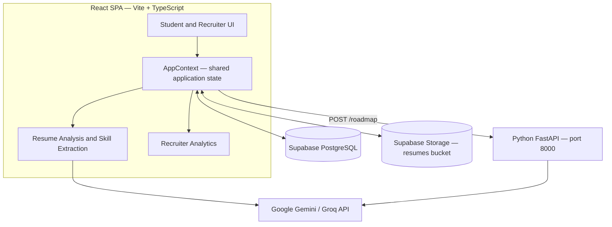

<div align="center">

# Transparently

### Make every application more informed.

**An AI-assisted resume analysis and job-matching platform connecting students with recruiters.**

[](https://react.dev/)
[](https://www.typescriptlang.org/)
[](https://vite.dev/)
[](https://supabase.com/)
[](https://fastapi.tiangolo.com/)
[](https://www.python.org/)

</div>

---

## Overview

**Transparently** is a web-based Applicant Tracking System (ATS) designed to make resume screening and job matching more understandable for students and recruiters.

Students can upload a PDF resume, review an analysis of their resume, identify relevant skills, discover job opportunities, and track application progress. Recruiters can publish job openings, review candidates, manage hiring stages, leave feedback, and explore recruitment analytics.

The platform combines AI-assisted analysis with deterministic fallback logic so basic resume analysis can still run when an AI provider is unavailable.

## At a glance

| For students | For recruiters |
|---|---|
| Upload and analyse a PDF resume | Create and manage job postings |
| Review resume score, strengths, and improvement areas | Review applicants and candidate match scores |
| Extract and manage technical skills | Add notes and provide candidate feedback |
| Discover jobs based on skill compatibility | Move candidates through the hiring pipeline |
| Track applications and their status | View hiring funnel and candidate analytics |
| Generate a skill-gap learning roadmap | Identify top candidates and in-demand skills |

## Screenshots

### Resume analysis

The dashboard presents an overall resume score, a metric breakdown, and areas that may need improvement.


### Job discovery and student profile

Students can browse job postings and review the skills associated with their profile.

| Job board | Student profile |
|---|---|
|  |  |

### Recruiter workspace

Recruiters can review hiring metrics, create job postings, and evaluate candidates.

| Recruiter dashboard | Job management |
|---|---|
|  |  |

### Candidate review and application progress

| Applicant review | Application status and feedback |
|---|---|
|  |  |

## Core features

- **PDF resume processing:** Upload resumes, extract text, and analyse relevant information.
- **AI-assisted resume scoring:** Evaluate contact information, experience, keyword coverage, and skill coverage.
- **Fallback analysis engine:** Use regex-based checks when AI analysis cannot be completed.
- **Skill extraction:** Identify technical skills and normalize common aliases such as `nodejs` and `k8s`.
- **Job matching:** Compare candidate skills with job requirements and show a compatibility score.
- **Application tracking:** Follow applications through stages and view recruiter feedback.
- **Recruiter job management:** Create, update, and remove job postings.
- **Hiring analytics:** View application counts, hiring funnel, score distributions, leading candidates, and frequently requested skills.
- **Personalized growth roadmaps:** Identify missing job skills and generate suggested learning steps and a project idea.
- **Persistent data:** Store application data and resume files through Supabase.

## System architecture

Transparently uses three main components: a React single-page application, Supabase for persistence and file storage, and a Python FastAPI service for roadmap generation.



### Technology stack

| Layer | Technologies | Responsibility |
|---|---|---|
| Frontend | React 18, TypeScript, Vite | User interface and client-side workflows |
| UI and charts | Tailwind CSS, shadcn/ui, Framer Motion, Recharts | Styling, interactions, animations, and analytics visualizations |
| Database and storage | Supabase, PostgreSQL, Supabase Storage | User profiles, jobs, applications, and resume files |
| AI integrations | Groq and/or Google Gemini | AI-assisted resume analysis and structured feedback |
| Python API | FastAPI, Uvicorn | Roadmap generation and optional server-side resume analysis |
| PDF processing | PDF.js, PyPDF2 (backend path) | Extract text from uploaded PDF files |

## How the main workflows work

### 1. Resume analysis

1. A student uploads a PDF resume.
2. The file is stored in the Supabase `resumes` bucket.
3. PDF text is extracted in the browser.
4. The application checks whether the extracted content resembles a resume.
5. The AI analysis engine evaluates the resume. If the AI provider fails, the local regex-based engine provides a fallback.
6. Detected skills and analysis results are saved to the student's profile in Supabase.

### 2. Resume scoring

The AI analysis prompt uses a weighted score composed of four dimensions:

```text
overall_score =
    (contact_info_score × 0.10) +
    (experience_score   × 0.40) +
    (keyword_score      × 0.25) +
    (skill_coverage     × 0.25)
```

The score is intended to provide structured feedback about a resume. It is an application-generated indicator, not a guarantee of interview selection or employment.

### 3. Skill extraction and job matching

The skill extraction layer can use AI-based extraction and a regex-based synonym library. The fallback matches known skill names and aliases, normalizes them to canonical names, and removes duplicates.

The application compares the candidate's normalized skills with the skills requested for a job to identify matches and gaps.

### 4. Growth roadmap

When a student applies for a job, the application can send the student's skills, the job title, and required job skills to the FastAPI `POST /roadmap` endpoint. The backend calculates missing skills and requests a learning roadmap from Gemini. The response can include learning steps, difficulty levels, estimated time, and a project idea. A basic fallback roadmap is available if the AI request fails.

### 5. Recruiter analytics

Recruiter dashboard metrics are computed in the frontend from the loaded jobs and applications. These include application counts by stage, average score, hiring rate, top candidates, and frequently requested skills.

## Application pipeline

```text
Applied → Screened → Shortlisted → Interview → Selected
    └────────────── can be rejected at any stage ──────────────┘
```

Recruiters can update application statuses, while students can follow the progress and review available feedback.

## Getting started

### Prerequisites

- Node.js **20.19+ or 22.12+**
- Python **3.10+** for the FastAPI service
- A Supabase project
- A Groq API key, Gemini API key, or both for AI-powered resume analysis

### 1. Clone the repository

Replace `<repository-url>` with the URL of your GitHub repository.

```bash
git clone <repository-url>
cd transparently
npm install
```

### 2. Configure Supabase

The current Supabase client is initialized in `src/lib/supabase.js`.

- Configure the client with your Supabase project URL and anon/public key.
- Create the database tables used by the application, including `users`, `student_profiles`, `jobs`, `applications`, `application_feedback`, and `recruiter_notes`.
- Create the `resumes` Storage bucket.
- Configure suitable PostgreSQL Row Level Security (RLS) policies and Storage access policies.

The repository does not currently include database migrations or a complete SQL setup script. Review the queries in `src/contexts/AppContext.tsx` and the relevant student and recruiter pages before creating the schema.

### 3. Configure AI provider keys

Create a `.env` file in the repository root:

```env
VITE_GROQ_API_KEY=your_groq_api_key
VITE_GEMINI_API_KEY=your_gemini_api_key
```

At least one provider key is needed for AI-powered resume analysis. When both keys are configured, the current frontend integration attempts Groq first and uses Gemini as a fallback. The application also includes a local non-AI analysis fallback.

**Security:** Variables prefixed with `VITE_` are bundled into frontend code and are visible to users. This configuration is suitable for local development and prototypes, not for protecting API keys in a public production deployment. Use a server-side proxy for production AI requests.

### 4. Configure the Python backend (optional)

Create a virtual environment from the repository root:

```bash
python -m venv backend/venv
```

Activate it:

```powershell
# Windows PowerShell
.\backend\venv\Scripts\Activate.ps1
```

```bash
# macOS/Linux
source backend/venv/bin/activate
```

Install dependencies:

```bash
pip install -r backend/requirements.txt
```

Create `backend/.env`:

```env
GEMINI_API_KEY=your_gemini_api_key
```

The FastAPI backend provides `POST /roadmap` and an alternative `POST /analyze` endpoint. The frontend primarily handles resume analysis through its TypeScript AI integration; the roadmap endpoint is used for skill-gap learning plans.

## Run locally

### Windows

After configuring the frontend and Python backend, run:

```bash
npm run dev
```

The combined development script is configured for the Windows virtual-environment path.

### macOS/Linux

Run the frontend and backend in separate terminals.

Terminal 1 — from the repository root:

```bash
npm run dev:frontend
```

Terminal 2 — activate `backend/venv`, then run from the repository root:

```bash
cd backend
python -m uvicorn main:app --reload
```

### Local URLs

| Service | URL |
|---|---|
| Vite frontend | http://localhost:5173 |
| FastAPI backend | http://localhost:8000 |
| FastAPI health check | http://localhost:8000/health |

## Useful commands

```bash
npm run dev          # Start frontend and backend together (Windows setup)
npm run dev:frontend # Start the Vite frontend
npm run build        # Build the frontend for production
npm run preview      # Preview the production build
npm run lint         # Run ESLint
npm test             # Run Vitest tests
npm run test:watch   # Run Vitest in watch mode
```

## Testing

Run the frontend tests with:

```bash
npm test
```

The Vitest configuration is set up to discover test files under `src/` with `.test.ts`, `.test.tsx`, `.spec.ts`, or `.spec.tsx` names.

## Security and limitations

- **Custom authentication:** The current application uses a custom name-based flow and stores the user object in `localStorage`; it does not use Supabase Auth. This should not be treated as production-grade authentication.
- **Database access:** Configure and test Supabase RLS and Storage policies before exposing real user data.
- **API keys:** Never commit `.env` files or expose secret provider credentials in client-side code. Never place a Supabase service-role key in the frontend.
- **AI output:** Resume scores and recommendations are automated estimates and may be inaccurate. They should support—not replace—human review.
- **Job availability:** The platform works with jobs entered into its own database; it does not currently integrate with external job portals in real time.
- **No placement guarantee:** A match score does not guarantee that a candidate will be selected or hired.

## Future scope

Potential extensions include semantic skill matching, live job-portal integrations, interview scheduling, multilingual support, a mobile application, and expanded recruitment analytics.

## License

No `LICENSE` file is currently included. Unless a license is added, the repository does not explicitly grant permission to reuse, modify, or redistribute the code.
